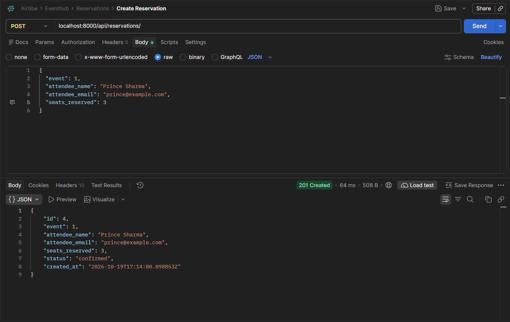
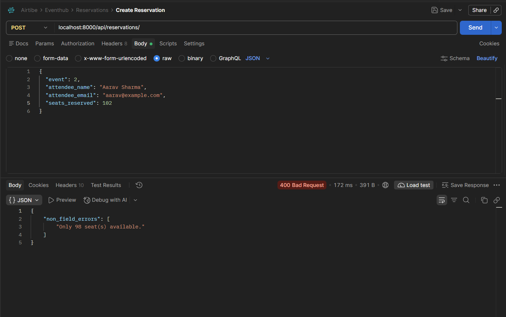
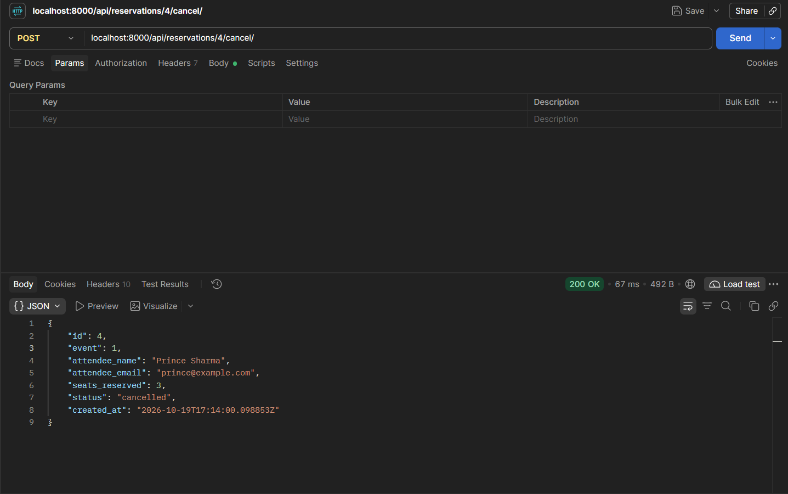

# 🎟️ EventHub --- Event Ticketing API

> A Django REST Framework API for browsing events, reserving seats, and
> cancelling reservations.

EventHub is a simplified backend for an event ticketing platform. Users
can browse events, reserve seats for upcoming or ongoing events, and
cancel reservations. The API tracks seat availability and validates
reservation requests to help prevent overbooking.

The project is built with **Python, Django, Django REST Framework, and
Django ORM**, with SQLite as the default database.

------------------------------------------------------------------------

## ✨ Features

- 🎟️ Create, retrieve, update, and delete events
- 🔎 Filter events by status and venue
- 🪑 Reserve one or more seats for an event
- ✅ Validate seat counts and event status
- 🚫 Reject reservations when there are not enough seats available
- ↩️ Cancel reservations and restore the reserved seats
- 🔍 Filter reservations by event ID
- 📊 Include the number of confirmed reservations in event responses
- 🕒 Automatically record creation timestamps
- 🧾 Validate request data with DRF serializers
- 🪵 Log request method, path, response status, and duration using
  custom middleware
- 🧭 Use ViewSets and a DefaultRouter for RESTful URL routing

------------------------------------------------------------------------

## 🛠️ Tech Stack

| Technology            | Purpose                                         |
|-----------------------|-------------------------------------------------|
| Python                | Programming language                            |
| Django                | Backend web framework                           |
| Django REST Framework | REST API development, serializers, and ViewSets |
| Django ORM            | Models and database Queries                     |
| PostgreSQL            | Databse                                         |
| Postman               | API testing                                     |

------------------------------------------------------------------------

# 🚀 Getting Started

Follow the steps below to create the project from scratch.

## 1. Create the project folder

Open PowerShell or Command Prompt:

``` powershell
mkdir eventhub
cd eventhub
```

## 2. Create and activate a virtual environment

Create the virtual environment:

``` powershell
python -m venv .venv
```

Activate it on Windows:

``` powershell
.venv\Scripts\activate
```

After activation, your terminal should show `(.venv)`.

## 3. Install dependencies

``` powershell
pip install django djangorestframework
```

Generate `requirements.txt`:

``` powershell
pip freeze > requirements.txt
```

Install dependencies later on another machine with:

``` powershell
pip install -r requirements.txt
```

## 4. Create the Django project and app

If you are starting from scratch, run:

``` powershell
django-admin startproject eventhub .
python manage.py startapp events
```

The `.` after `eventhub` keeps `manage.py` in the current project
directory.

Your project will now look approximately like:

```text
eventhub/
│
├── manage.py
│
├── eventhub/
│   ├── settings.py
│   ├── urls.py
│   └── ...
│
└── events/
    ├── migrations/
    ├── __init__.py
    ├── admin.py
    ├── apps.py
    ├── models.py
    ├── tests.py
    └── views.py
```

# ⚙️ Project Configuration

## 5. Configure the project

Add `rest_framework` and `events` to `INSTALLED_APPS` in
`eventhub/settings.py`:

``` python
INSTALLED_APPS = [
    # Default Django apps...
    'rest_framework',
    'events',
]
```

Add the custom middleware to the `MIDDLEWARE` list in
`eventhub/settings.py`:

``` python
'events.middleware.RequestLoggingMiddleware',
```

Make sure the app URLs are included in `eventhub/urls.py`, for example:

``` python
from django.urls import include, path

urlpatterns = [
    # Default Django admin route, if retained...
    path('api/', include('events.urls')),
]
```

In `events/urls.py`, register the Event and Reservation ViewSets with a
DRF `DefaultRouter`.

## 6. Create and apply migrations

``` powershell
python manage.py makemigrations
python manage.py migrate
```

Commit the generated files in `events/migrations/` to your repository.

## 7. Run the Project

Start the Django development server:

``` powershell
python manage.py runserver
```

The API will be available at:

``` text
http://127.0.0.1:8000/
```

All API routes are prefixed with:

```text
/api/
```

------------------------------------------------------------------------

# 📁 Project Structure

``` text
eventhub/
├── manage.py
├── requirements.txt
├── README.md
├── db.sqlite3
│
├── eventhub/
│   ├── __init__.py
│   ├── settings.py
│   ├── urls.py
│   ├── asgi.py
│   └── wsgi.py
│
└── events/
    ├── __init__.py
    ├── admin.py
    ├── apps.py
    ├── models.py
    ├── serializers.py
    ├── views.py
    ├── urls.py
    ├── middleware.py
    ├── tests.py
    └── migrations/
```

------------------------------------------------------------------------

# 🧱 Data Models

## Event

An `Event` stores information about an event and its seat inventory.

| Field             |                    Description                     |
|:------------------|:--------------------------------------------------:|
| `title`           |                    Event title                     |
| `venue`           |                   Event location                   |
| `date`            |                     Event date                     |
| `total_seats`     |                   Total capacity                   |
| `available_seats` |        Seats currently available to reserve        |
| `status`          | `upcoming`, `ongoing`, `completed`, or `cancelled` |
| `created_at`      |     Automatically recorded creation timestamp      |

The event response also includes `reservations_count`, a computed count
of confirmed reservations.

## Reservation

A `Reservation` represents seats reserved by an attendee for an event.

| Field            |                Description                |
|:-----------------|:-----------------------------------------:|
| `event`          |     Foreign key to the related event      |
| `attendee_name`  |              Attendee's name              |
| `attendee_email` |         Attendee's email address          |
| `seats_reserved` |         Number of seats reserved          |
| `status`         |        `confirmed` or `cancelled`         |
| `created_at`     | Automatically recorded creation timestamp |

### Relationship

One event can have many reservations. The `Reservation.event` foreign
key defines this one-to-many relationship, and the related reservations
can be accessed through `event.reservations`.

------------------------------------------------------------------------

# 🔌 API Endpoints

All endpoints accept and return JSON. Include a trailing slash in each
URL.

## 🎫 Event APIs

|  Method  | Endpoint                       |    Description    |
|:--------:|:-------------------------------|:-----------------:|
|  `GET`   | `/api/events/`                 |    List events    |
|  `POST`  | `/api/events/`                 |  Create an event  |
|  `GET`   | `/api/events/<id>/`            | Retrieve an event |
|  `PUT`   | `/api/events/<id>/`            |  Update an event  |
| `DELETE` | `/api/events/<id>/`            |  Delete an event  |
|  `GET`   | `/api/events/?status=upcoming` | Filter by status  |
|  `GET`   | `/api/events/?venue=bangalore` |  Filter by venue  |

### Filter events

Filter by status:

``` text
GET /api/events/?status=upcoming
```

Filter by venue (case-insensitive partial match):

``` text
GET /api/events/?venue=bangalore
```

You can combine filters:

``` text
GET /api/events/?status=upcoming&venue=bangalore
```

Supported event statuses:

``` text
upcoming
ongoing
completed
cancelled
```

### Create an event

**POST**

```text
/api/events/
```

### Request

``` json
{
  "title": "Django Developers Meetup",
  "venue": "Bengaluru Convention Centre",
  "date": "2026-12-15",
  "total_seats": 100,
  "available_seats": 100,
  "status": "upcoming"
}
```

The API validates that `available_seats` does not exceed `total_seats`.

The event response includes a computed `reservations_count` field.

------------------------------------------------------------------------

## 🪑 Reservation APIs

| Method | Endpoint                         |              Description               |
|:------:|:---------------------------------|:--------------------------------------:|
| `GET`  | `/api/reservations/`             |           List reservations            |
| `POST` | `/api/reservations/`             |          Create a reservation          |
| `GET`  | `/api/reservations/<id>/`        |         Retrieve a reservation         |
| `GET`  | `/api/reservations/?event_id=1`  |            Filter by event             |
| `POST` | `/api/reservations/<id>/cancel/` | Cancel a reservation and restore seats |

The list, create, and retrieve routes are provided by DRF's `ModelViewSet`.
The custom cancellation route is provided by an
`@action(detail=True, methods=['post'])` method.

### Filter reservations by event

``` text
GET /api/reservations/?event_id=1
```

This returns reservations associated with event ID `1`.

### Create a reservation

**POST**

```text
/api/reservations/
```

### Request:

``` json
{
  "event": 1,
  "attendee_name": "Priya Sharma",
  "attendee_email": "priya@example.com",
  "seats_reserved": 2
}
```

A successful request returns `201 Created`. The reservation status
defaults to `confirmed`, and the event's `available_seats` value is
reduced by the number of seats reserved.

### Example successful response

``` json
{
  "id": 1,
  "event": 1,
  "attendee_name": "Priya Sharma",
  "attendee_email": "priya@example.com",
  "seats_reserved": 2,
  "status": "confirmed",
  "created_at": "2026-10-19T10:00:00Z"
}
```

The exact ID and timestamp will depend on the database and request time.

### Overbooking validation

A reservation must request at least one seat. Reservations are rejected
if the requested seat count exceeds the event's current available seats
or if the event is not `upcoming` or `ongoing`.

For example, if only one seat is available and the request asks for two,
the API should return `400 Bad Request` with a validation message
similar to:

``` json
{
  "non_field_errors": [
    "Only 1 seat(s) available."
  ]
}
```

### Cancel a reservation

**POST**

```text
/api/reservations/1/cancel/
```

No request body is required.

On successful cancellation:

- The reservation status changes to `cancelled`.
- The reserved seats are returned to the event's `available_seats`.
- The updated reservation is returned in the response.

Attempting to cancel an already-cancelled reservation returns
`400 Bad Request`.

------------------------------------------------------------------------

# 🪵 Request Logging Middleware

`RequestLoggingMiddleware` measures how long a request takes and logs
the request method, path, response status, and duration.

Example log format:

``` text
GET /api/events/ - 200 - 0.02s
```

The middleware is defined in `events/middleware.py` and must be
registered in the `MIDDLEWARE` list in `eventhub/settings.py`.

------------------------------------------------------------------------

# 🧠 Design Decision

### Why use `time.monotonic()` in the request logging middleware?

The middleware uses `time.monotonic()` to measure elapsed request time. Unlike
wall-clock time, a monotonic clock is not affected by system clock changes, so
the duration remains reliable even if the system time is adjusted while a
request is being handled.

### Why don't we customize `get_queryset()`?

Both viewsets use `get_queryset()` to return all events or reservations. We
don't add request-specific restrictions because the current API has no
user-specific data access rules. Event and reservation filtering is handled
by the configured filter fields. If access later needs to depend on the
requesting user, `get_queryset()` is the right place to scope those results.

### Why keep reservation creation and seat deduction together?

For this assignment, the seat deduction and reservation creation are
handled in `ReservationSerializer.create()`, keeping the two related
operations in one place and following the provided project requirements.

This approach is straightforward for learning Django REST Framework
serializers and model operations. However, a normal sequence of read,
update, and create operations does not by itself prevent race conditions
when multiple users try to reserve the last available seat at the same
time.

For a production implementation, I would use a database transaction and
suitable concurrency control, such as row locking on a database that
supports it, so that seat availability is checked and updated safely. I
would also consider moving booking business logic into a dedicated
service layer as the application grows.

------------------------------------------------------------------------

# 🧪 Testing with Postman

Use Postman to test the API. Start the Django server first:

``` powershell
python manage.py runserver
```

Recommended test flow:

1. **Create an event** --- `POST /api/events/`
2. **List events** --- `GET /api/events/`
3. **Filter events by status** --- `GET /api/events/?status=upcoming`
4. **Filter events by venue** --- `GET /api/events/?venue=bangalore`
5. **Create a reservation** --- `POST /api/reservations/`
6. **Verify seat deduction** --- retrieve the event and check
   `available_seats`
7. **Attempt to overbook** --- request more seats than are available
   and verify `400 Bad Request`
8. **Cancel a reservation** --- `POST /api/reservations/<id>/cancel/`
9. **Verify seat restoration** --- retrieve the event and check
   `available_seats`
10. **Filter reservations by event** ---
    `GET /api/reservations/?event_id=<id>`
11. **Check middleware logs** --- inspect the terminal output for
    request logs

------------------------------------------------------------------------

# 📸 Postman API Screenshots

The following screenshots demonstrate the API endpoints tested using Postman.

## 1. Successful Reservation --- 201 Created

Request: `POST /api/reservations/`



## 2. Overbooking Failure --- 400 Bad Request

Request: `POST /api/reservations/` with more seats than are available.



## 3. Successful Cancellation

Request: `POST /api/reservations/<id>/cancel/`



------------------------------------------------------------------------

# 📋 API Quick Reference

``` text
EVENTS
────────────────────────────────────────────
GET     /api/events/
POST    /api/events/
GET     /api/events/<id>/
PUT     /api/events/<id>/
DELETE  /api/events/<id>/
GET     /api/events/?status=upcoming
GET     /api/events/?venue=bangalore

RESERVATIONS
────────────────────────────────────────────
GET     /api/reservations/
POST    /api/reservations/
GET     /api/reservations/<id>/
GET     /api/reservations/?event_id=1
POST    /api/reservations/<id>/cancel/
```

------------------------------------------------------------------------

# 👩‍💻 Author

**EventHub**

Built as a Django REST Framework backend project to practice:

- Django models and ORM relationships
- DRF serializers and validation
- ModelViewSets and routers
- Query parameter filtering
- Custom actions with `@action`
- Middleware and request logging
- Reservation business logic
- Database migrations
- API testing with Postman

------------------------------------------------------------------------

## ⭐ Learning Goal

EventHub is intentionally small, but it brings together the core
components of a Django REST API:

``` text
HTTP Request
    ↓
Django URL Router
    ↓
ViewSet
    ↓
Serializer Validation
    ↓
Django ORM / Models
    ↓
Database
    ↓
HTTP Response
```

The goal is not just to make the endpoints work, but to understand how
API routing, validation, data modelling, and business rules fit together
in a complete backend application.
